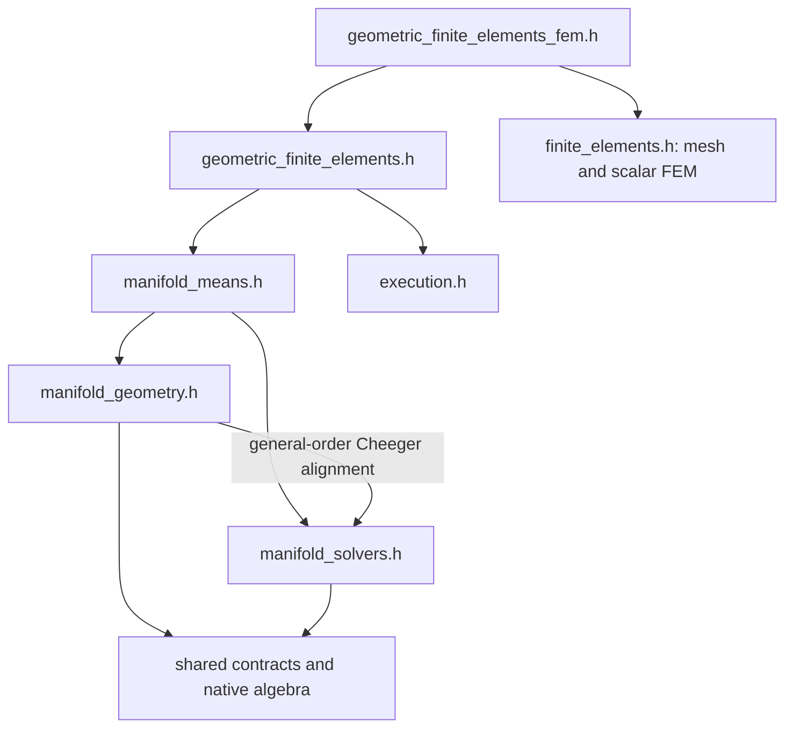

# Manifold modules

Geometry, optimization and mean algorithms have separate public entry points.
All retain the `fdapde::manifold` namespace and native matrix owners; no Eigen
dependency is introduced.

| Include | Exposed workflow |
|---|---|
| `<fdaPDE/manifold_geometry.h>` | Euclidean, product, SPD and SO geometries; metrics, maps, transport, geometric expressions and differentials |
| `<fdaPDE/manifold_solvers.h>` | Objective contracts, evaluation contexts, Armijo, steepest descent, trust regions and conjugate-gradient subproblems |
| `<fdaPDE/manifold_means.h>` | Generic weighted Karcher means and geometry-specific closed-form or refined implementations; includes geometries and solvers |

For example, an application that computes rotation distances can include
`manifold_geometry.h`; one computing SPD barycenters can include
`manifold_means.h`. Applications supplying their own geometry can use
`manifold_solvers.h` independently of the built-in geometries. Include the
modules required by the application explicitly.

## Responsibilities and dependencies

```text
src/manifold/
    concepts.h
    geometry/
        euclidean.h
        product_geometry.h
        geometry_expr.h
        geometry_common.h
        spd/
        so/
    optimization/
        problem.h
        evaluation_context.h
        armijo.h
        steepest_descent.h
        trust_region.h
        ...
    means/
        weighted_karcher_mean.h
        log_euclidean_mean.h
        log_cholesky_mean.h
        affine_invariant_mean.h
        bures_wasserstein_mean.h
        so_mean.h
```

The shared contracts define point/tangent types, required geometric operations
and the recoverable retraction-domain exception. Generic solvers depend on these
contracts and native algebra, without including concrete geometries or means.
Retraction trial recovery belongs to the optimization layer. Interpolation
bindings belong to the geometry interface, while P1 implementations remain in
`geometric_finite_elements`.

An arrow below points to a prerequisite:



General-order Cheeger geometry computes alignments with a generic trust-region
solver. Consequently, the complete geometry aggregate includes the solver
aggregate, but the reverse dependency is absent. This is intentional and does
not create an include cycle; including geometry does not import Karcher mean
implementations. The public split expresses ownership and permits independent
solver use, rather than promising that every geometry is solver-free.

Normalized Karcher algorithms and their result/option types live under `means/`.
The existing deferred LE `geometry.weighted_mean(...)` remains available with
geometry as an algebraic log-coordinate combination; it does not normalize its
weights or invoke an optimizer.

## Geometric finite elements as a discretization layer

`src/geometric_finite_elements/` is a separate module alongside `src/manifold/`
and `src/finite_elements/`. It combines manifold-valued nodal data with scalar P1
barycentric weights, spatial derivatives, quadrature and discrete energies.
Those operations belong to spatial discretization, while metrics, tangent maps
and weighted means remain in the manifold module.

`geometric_finite_elements.h` supplies native local P1 values and linearizations,
prepared stencils and energy contributions without importing Eigen or the scalar
FEM module. It also declares template-based spatial wrappers; instantiating
`GeometricFeSpace` and mesh-backed field evaluation requires the spatial types.
`geometric_finite_elements_fem.h` supplies that integration by including both
modules and the adapter for scalar FEM quadrature, DOFs and lumped stencils.

The dependency direction is therefore from discretization to manifold
operations. Geometry headers expose forward-declared P1 interpolation bindings
for the existing convenience API; their implementations are supplied by the
geometric finite element module. They do not include that module. This keeps
geometry and generic solver use independent of spatial discretization.

## Verification

Applications should include public aggregates instead of internal `src/` paths.
Separate translation units compile each aggregate first, instantiate its APIs,
and then compose it with the other aggregates. They also reject accidental geometry/mean imports into
the solver aggregate and mean imports into the geometry aggregate.

The [example index](../examples/README.md) maps the public workflows to standalone
programs using the corresponding entry points.
